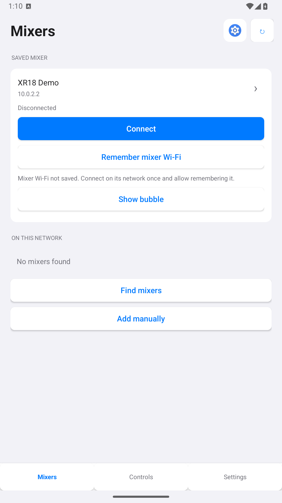
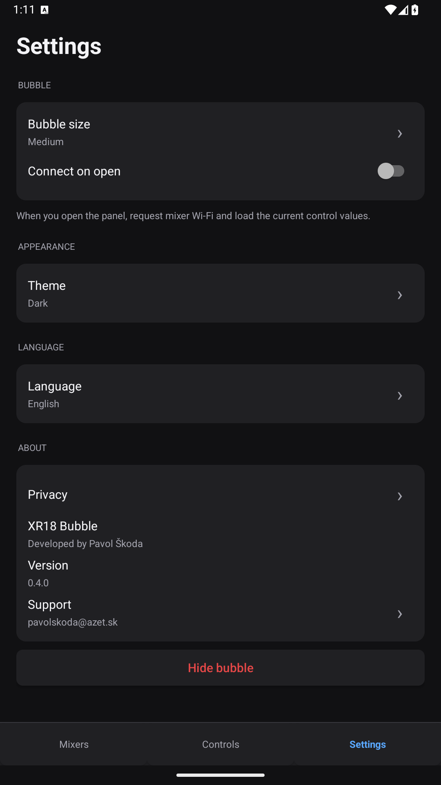
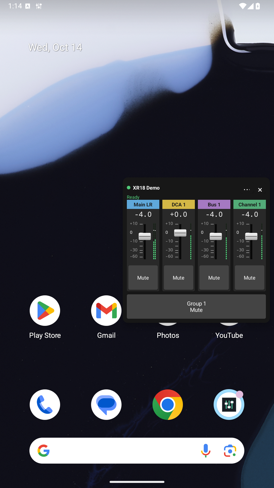

# XR18 Bubble

A small floating Android controller for the mixer controls you need during a performance.

## Why I built it

I built XR18 Bubble for the moment when the soundcheck is finished and it is time to play.

Mixing Station is a great, versatile app for setting up and controlling a mixer. But during a performance, I often need just one quick action: adjust the master or a DCA level, mute a group, or change one channel. If my phone is on another Wi-Fi network, that small action becomes a sequence of steps: reconnect to the mixer network, find and open the mixer app, select the mixer, find the right control, and finally make the change.

I wanted a small bubble at the edge of the screen that I could open from whatever app I was using, with only the controls I had chosen. The panel should fit those controls: a mute group needs one button, while a channel may need a fader and a mute button. It should request the remembered mixer Wi-Fi, load the current values before enabling the controls, show live signal levels, and offer a convenient way back to the previous network when possible.

That is the idea behind XR18 Bubble: keep a few essential controls within reach, with a shortcut back to Mixing Station whenever I need the full mixer interface.

Developed by **Pavol Škoda**. Free to use, with no ads, analytics, accounts or cloud backend.

## Download

Download the APK from [Releases](https://github.com/palkoskoda/xr18-bubble/releases). The first public release is a beta; test it with your phone and mixer before using it during a performance. Android may ask you to allow installation from the browser or file manager you use to open the APK.

Android 10 or newer is required. The app is designed for Behringer XR18/X18 and Midas MR18 mixers using the local X AIR OSC/UDP protocol. Real-hardware verification so far covers an XR18 and an Android 16 phone; broader device and firmware coverage is still needed.

## Features

- Floating bubble above other apps; drag it to either screen edge.
- Choose from master, four DCAs, four mute groups, six buses and sixteen channels.
- Add or remove controls with checkboxes; choose volume, mute or both where available.
- Adaptive panel layout, three control sizes, three bubble sizes and custom labels.
- Live signal meters with peak hold, including stereo master levels.
- Remember the mixer Wi-Fi after a verified mixer response and request it when opening the panel.
- Return-to-Wi-Fi button and close prompt after an opening that changed the network. Staying at the mixer does not cause repeated prompts on subsequent openings on the same network.
- Configurable app shortcut next to refresh: tap to open, hold to select another installed app.
- System, light and dark appearance. The live control panel keeps its dark stage palette.
- Twelve offline interface languages: English, Slovak, Czech, German, Polish, Hungarian, French, Spanish, Italian, Portuguese, Dutch and Ukrainian.

## First use

1. Connect your phone to the mixer Wi-Fi. Open **Mixers**, refresh the list and select your mixer, or enter its address manually.
2. Allow Wi-Fi identity access if you want the network remembered. Android requires precise location permission and Location enabled to expose the SSID; the app does not use GPS. Secured Wi-Fi requires entering its password once.
3. Open **Controls** and select what you want in the floating panel.
4. Choose **Show bubble** and allow display over other apps. Enable notifications for the running service when requested.
5. Open the bubble. Controls become active only after the mixer is verified and all selected values are synchronized.

Android may require confirmation when requesting Wi-Fi. A completely silent switch is not guaranteed. A local secondary connection for this app may leave other apps, including Mixing Station, on a different default network. Returning releases the app's request; Android decides which available saved network to restore.

## Screenshots

The screenshots use a local **XR18 Demo** simulator. They demonstrate the interface and meters, not additional real-hardware tests.

  

## Documentation and support

- [Slovak user guide](docs/POUZIVATELSKA_PRIRUCKA.md)
- [Testing and coverage](TESTING.md)
- [Privacy policy](https://palkoskoda.github.io/xr18-bubble/privacy.html)
- [Build and release guide](BUILDING.md)
- [Report an issue](https://github.com/palkoskoda/xr18-bubble/issues)
- Support: [pavolskoda@azet.sk](mailto:pavolskoda@azet.sk)

When reporting a problem, include your phone/Android version, mixer/firmware and the steps to reproduce it. Do not attach Wi-Fi passwords or signing keys.

## Privacy and independence

Settings stay on the device. Saved Wi-Fi passwords use Android Keystore-backed encryption. There are no tracking SDKs or developer data uploads. The mixer protocol sends unencrypted local UDP traffic, so use a trusted network.

XR18 Bubble is an independently written companion. It is not affiliated with or endorsed by Behringer, Midas, Music Tribe or Mixing Station. No Mixing Station code, APK or artwork is included.

An open-source license has not yet been selected. F-Droid inclusion is not claimed.
