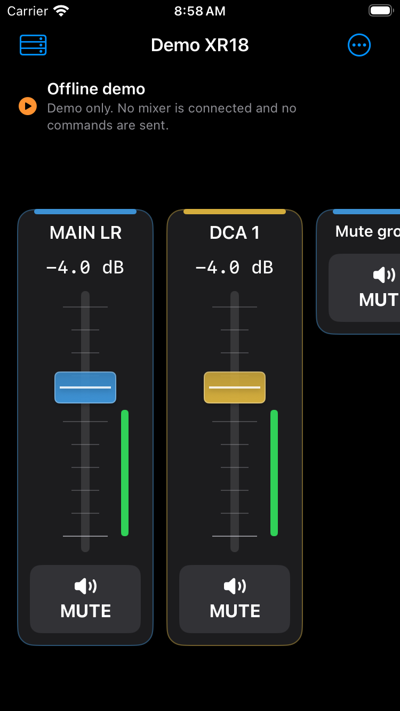
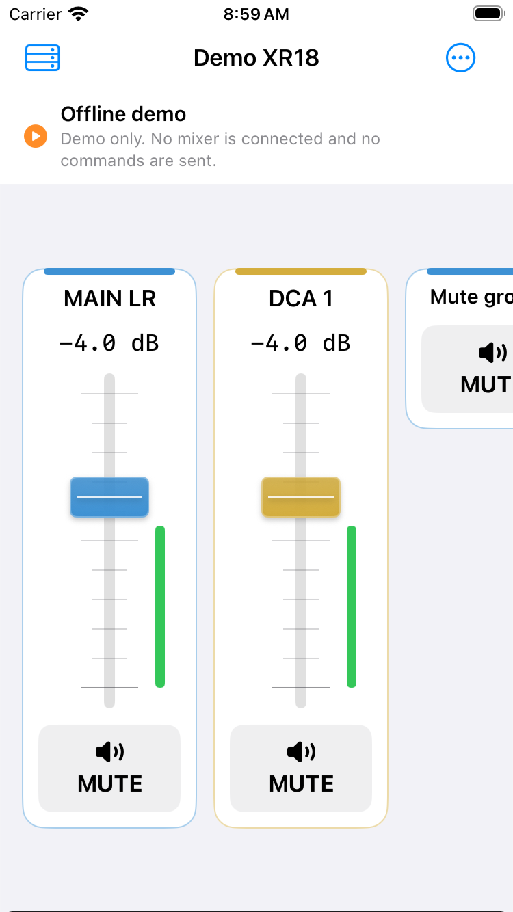
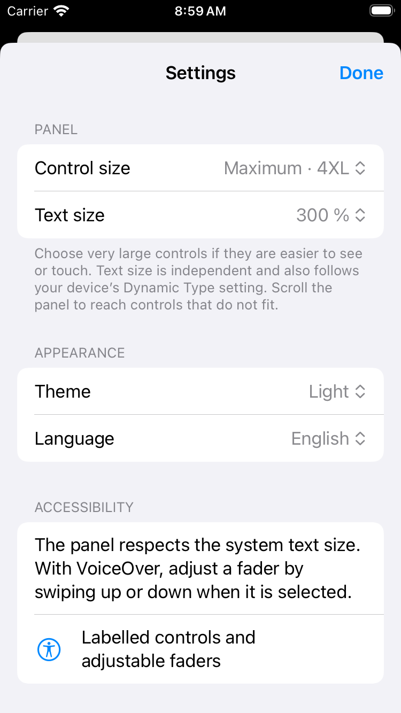
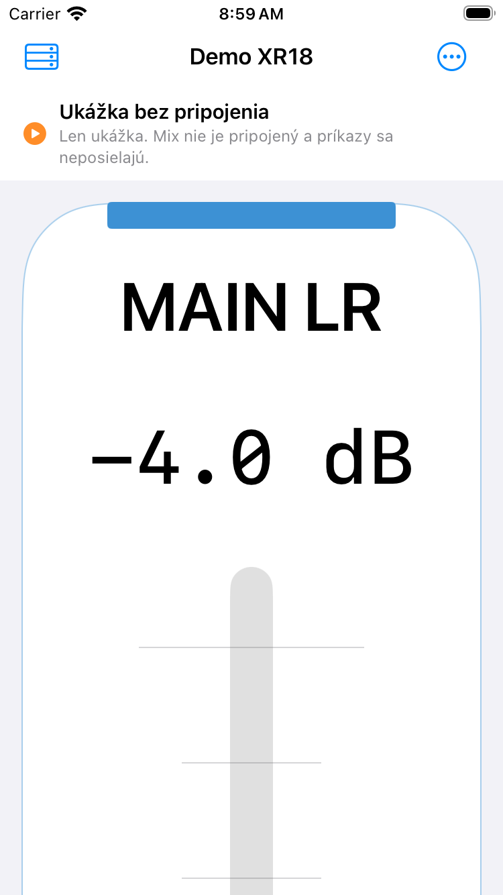
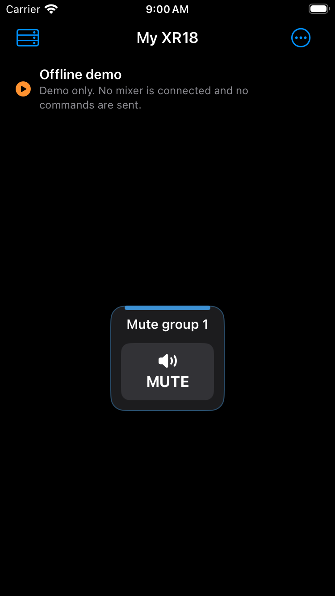
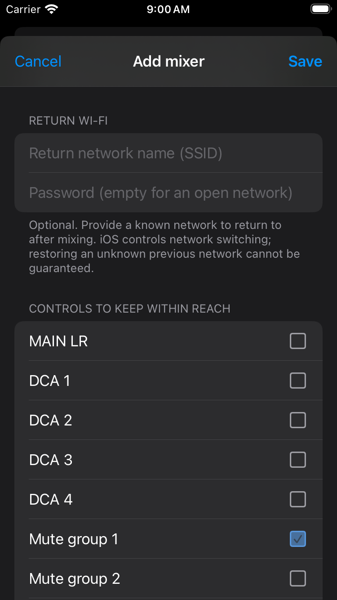
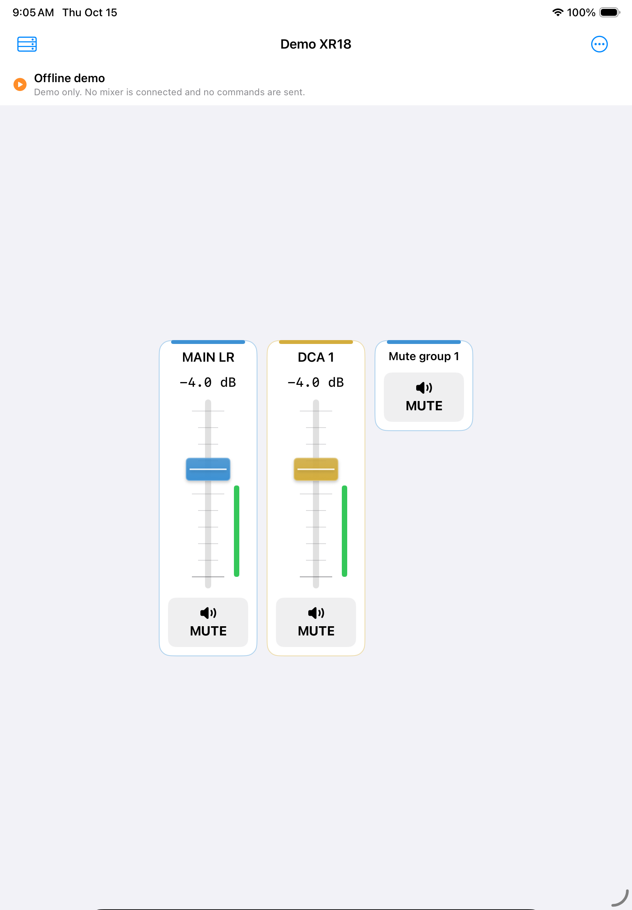
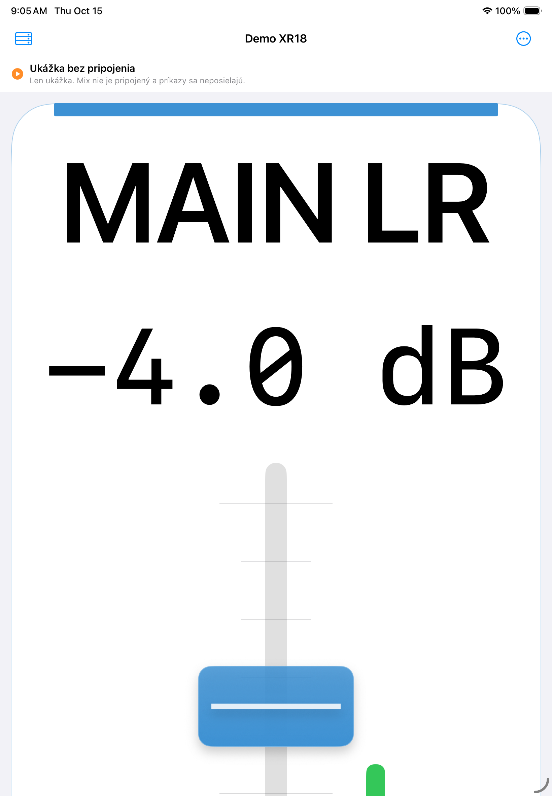
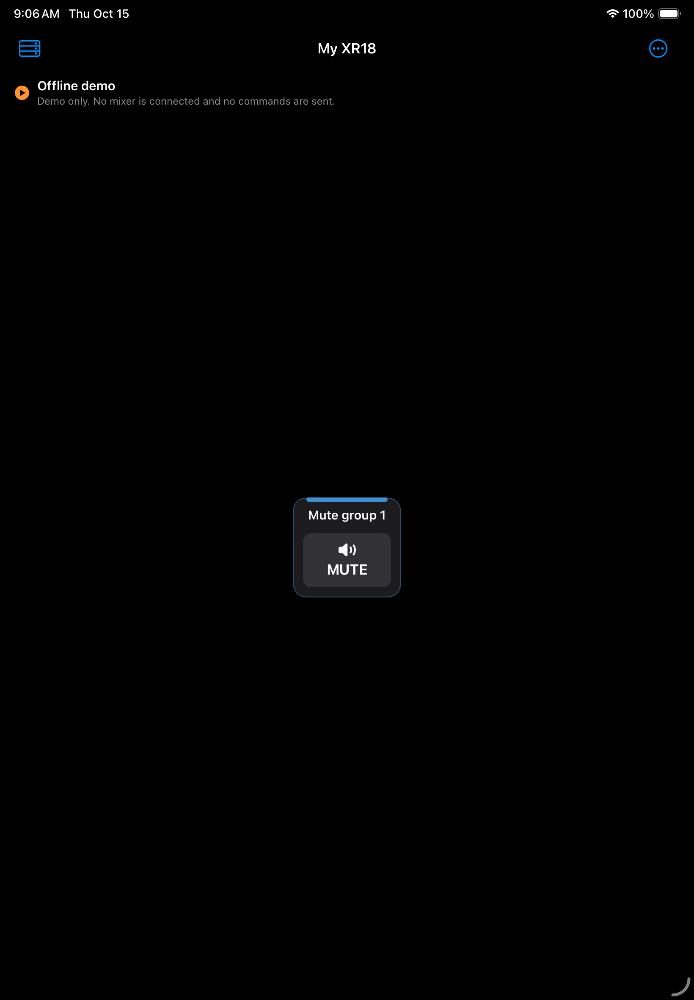

# Native Apple preview screenshots

These are actual, unmodified iOS simulator captures from [passing run 38708663324](https://github.com/palkoskoda/xr18-bubble/actions/runs/38708663324), feature commit `f4ade7d`. Every mixer view shown here is explicitly marked as an offline demo. They are development previews, not App Store marketing screenshots or proof of physical Wi-Fi operation.

## iPhone SE (3rd generation)

| Dark | Light | Settings |
| --- | --- | --- |
|  |  |  |

| Slovak, 4XL and 300% text | One mute-group button | Control selection |
| --- | --- | --- |
|  |  |  |

## iPad (10th generation)

| Light | Slovak, 4XL and 300% text | One mute-group button |
| --- | --- | --- |
|  |  |  |
